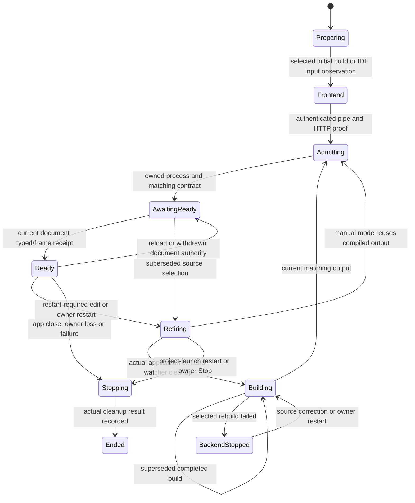

# Consumer setup and coordinator review

Review for [#34](https://github.com/sotsera/spar/issues/34), reviewed against
`7a0f482bb22dd9ef8bed3b9ed987dd5b254509b2` (2026-10-21). This is a source-based design
review, not API documentation or integration acceptance for the remaining proposals. The maintainer
accepted the sequence after merging PR #39; C1 and C2 are separate implementations below.
Current commands remain in the [minimal application](23-minimal-application.md)
and [package consumer](18-package-consumer.md) guides.

## Recommendation and delivery boundaries

Proceed in small, separately reviewable steps:

1. **C1: trim redundant scaffold configuration using existing defaults.** No new inference or protocol.
2. **C2: offer an optional development startup helper.** Move the repeated session/bootstrap/window wiring
   behind one Debug-only public method, retaining explicit contracts and permissions and the existing lower-level API.
3. **K1: encapsulate the watcher resources only.** One internal owner can replace five independently mutable
   fields with a shared lifetime. Keep restart/build/admission decisions in `DevelopmentSession`.

Keep the current package split, early restore properties, explicit contract project and central coordinator
sequencing. Defer a custom MSBuild SDK, inferred build output paths, a general lifecycle framework and
additional extraction of already cohesive inspection logic. Neither fewer files nor fewer lines alone
justifies a new abstraction. C1, C2 and K1 are separate PR scopes, not newly published issues.
C1 removed the redundant scaffold values in PR #40. C2 adds the optional startup helper in a separate
implementation; its validation is separate from this review. K1 remains future work.

## Consumer: the current minimum

The authoritative scaffold is [New-PackageConsumer.ps1](../eng/New-PackageConsumer.ps1), using the
ordinary `samples/` sources by default. The source-checkout app intentionally has framework project references;
the external consumer instead uses public packages and its own app-to-contract project reference.

| Required concern | Current application-owned setup | Why it exists |
| --- | --- | --- |
| SDK and dependencies | `global.json`, central package versions, ordinary SDK projects | Reproducible selected SDK; compatible consumer dependency resolution remains possible. |
| App project | `net10.0-windows`, `win-x64`, executable, generated COM, frontend exclusions, three package-reference declarations and conditional contract reference | Native host plus Debug development tooling or Release host; frontend saves must not enter the backend watch build. |
| Contract project | `net10.0`, `IsAotCompatible`, explicit contract file/client output, Bridge and private Build references, no Debug symbols | Generated direct dispatch/JSON/TS; contract wire metadata cannot be patched independently of the client. |
| Initial restore | App declares `EnableAotAnalyzer`, `EnableTrimAnalyzer`, conditional `PublishAot` and `SelfContained` | The first restore cannot assume package targets have already been imported. |
| Delivery | Default NativeAOT; explicit compatibility attribution and strict override when needed | No automatic fallback for framework, compilation or tool failures. |
| Shared build properties | Nullable/usings/warnings, source mapping, source root and development tools directory | Compiler policy, debugger source identity and the generated consumer's `.tools` location. |
| Debug startup | `Program.cs` dispatch plus `Program.Development.cs`: project bootstrap, connection, native options and attachment | The same app participates in terminal, VS Code and Visual Studio ownership without a second update engine. |
| Production startup | `Program.Production.cs`: open embedded archive, build bridge, run window with profile | Explicit resource/permission/profile ownership; no development reference or observer in Release. |
| Frontend | Framework's config, generated client import/connect, explicit user mutations, read invalidation on backend updates | Vite/React own HMR; application owns when data is refreshed. Mutation replay remains prohibited. |
| Session and editors | `spar.dev.json`, Visual Studio project profile, VS Code `spar` launch config/local adapter | Explicit project/output/client paths and one selected Hot Reload owner. |
| Local packaging test | `.feed`, isolated NuGet source mapping/cache, `consumer.json` | This is local package qualification infrastructure, not a required production runtime concept. |

Five Spar packages are **produced for the local feed**; each configuration selects a subset. The application
does not explicitly reference all five. The scaffold declares four distinct package IDs across its two
projects, with five reference declarations:

```xml
<!-- Application: unchanged in the recommendation. Versions are central. -->
<PackageReference Include="Sotsera.Spar.Build" PrivateAssets="all" />
<PackageReference Include="Sotsera.Spar.Windows" Condition="'$(Configuration)' != 'Debug'" />
<PackageReference Include="Sotsera.Spar.Development" Condition="'$(Configuration)' == 'Debug'" PrivateAssets="all" />
<ProjectReference Include="$(SparContractProject)" Condition="'$(DotNetWatchBuild)' != 'true'"
                  GlobalPropertiesToRemove="RuntimeIdentifier;PublishAot;SelfContained" />

<!-- Separate contract project. -->
<PackageReference Include="Sotsera.Spar.Bridge" />
<PackageReference Include="Sotsera.Spar.Build" PrivateAssets="all" />
```

`Sotsera.Spar.Windows.Development` arrives through the Debug development package; it is a distinct artifact
with the same host assembly identity and inspection code compiled in. The Release host excludes that code.
[Host package validation](../build/Spar.NativePackage.targets) and
[development package validation](../build/Spar.DevelopmentPackage.targets) reject non-Debug misuse.
Merging these packages would need a new proof of that boundary; it is not a cosmetic package-count improvement.

The commands and ownership choice remain unchanged in all proposals:

| Workflow | Entry point after ordinary build/npm preparation | Backend update owner |
| --- | --- | --- |
| External terminal | `./.tools/Spar.Dev.exe spar.dev.json` | SDK watcher |
| VS Code | Load `.vscode/spar-extension`, select **Spar development**, F5; use **Spar: Restart backend** | C# debugger; adapter replaces watch mode |
| Visual Studio | Open `Consumer.slnx`, Debug / **Spar development**, F5; close, wait, rebuild and F5 for restart-required changes | Visual Studio; whole session ends for rebuild |
| Production | `dotnet publish backend/Spar.NativeSample.csproj -c Release -o artifacts/aot --disable-build-servers` | None; copied payload runs without coordinator or Node |

The [package guide](18-package-consumer.md) owns preparation, launch-profile relocation and full commands.
The [C2 execution record](evidence/development-startup-2026-10-21/README.md) supplies the later
minimal-app Visual Studio pass; the setup table alone is not execution evidence.

## C1: remove redundant values, preserve paths and ownership

External `spar.dev.json` at the reviewed baseline (property order normalized):

```json
{
  "project": "backend/Spar.NativeSample.csproj",
  "application": "backend/bin/Debug/net10.0-windows/win-x64/Spar.NativeSample.exe",
  "generatedClient": "backend/frontend/src/generated/client.js",
  "sessionDirectory": "artifacts/sessions",
  "watchBackend": true,
  "contractFile": "contracts/BackendContract.cs",
  "restartFiles": ["backend/Program.cs", "backend/Program.Development.cs"],
  "frontend": {
    "fileName": "cmd.exe",
    "arguments": ["/d", "/c", "npm", "run", "dev"],
    "workingDirectory": "backend/frontend",
    "port": 0
  }
}
```

Scaffold output after C1, using defaults already present in
[DevelopmentSettings](../src/Sotsera.Spar.Development/DevelopmentSettings.cs):

```json
{
  "project": "backend/Spar.NativeSample.csproj",
  "application": "backend/bin/Debug/net10.0-windows/win-x64/Spar.NativeSample.exe",
  "generatedClient": "backend/frontend/src/generated/client.js",
  "sessionDirectory": "artifacts/sessions",
  "watchBackend": true,
  "contractFile": "contracts/BackendContract.cs",
  "restartFiles": ["backend/Program.cs", "backend/Program.Development.cs"],
  "frontend": { "workingDirectory": "backend/frontend" }
}
```

**Benefit:** three redundant leaf properties disappear; all eight top-level properties remain. This is
authoring simplification, not removal of three runtime concepts. Existing explicit configurations stay valid.
Keep package manager/arguments overridable. `ConfigurationPreservesOmittedDefaults` already tests omitted
defaults, but the implementation PR must compare the full scaffold's effective settings and run a fresh consumer.

Do **not** silently default `watchBackend` to true, guess the executable from a filename convention, or
derive contract/client paths by searching the tree. Current JSON paths are relative to the configuration
file, not the project, and the default `sessionDirectory` is not the external scaffold's chosen directory.
Startup files are explicitly classified for restart. Custom output paths, assembly names and source roots
must not be reinterpreted. Keep the existing explicit `.tools` override because both editor profiles use it.

### Defaults considered but not selected

| Candidate | Decision and concrete reason |
| --- | --- |
| Move the four first-restore properties into the existing Build package | Reject: reduces visible XML only after restore; fresh restore must still obtain the right analyzer/AOT graph. A warm cache is not evidence. |
| Add a custom MSBuild SDK to supply those properties early | Defer: introduces SDK resolution/versioning and another authoring model to remove four declarations. No demonstrated benefit sufficient for this slice. |
| Generate the normal contract `ProjectReference` only from package targets | Reject for this review: the first restore needs the contract edge too. Preserve the immutable watch-time binary reference and `GlobalPropertiesToRemove`. |
| Default the frontend directory and compiler exclusions in package targets | Defer: project declarations and item evaluation happen before these late imports. An opt-in props convention needs fresh evaluation/restore proof and custom-layout coverage; do not quietly hide files. |
| Move contract no-symbol configuration into a package convention | Defer with other build conventions: it is a safety rule, not a removable requirement. Overrides, Debug configurations and debugger admission must remain explicit and tested. |
| Hide the contract assembly or merge Debug/Release host packages | Retain current design: both encode demonstrated contract/production boundaries. |
| Hide frontend connect/read invalidation in a React helper | Reject: it couples the runtime-facing example to a framework and obscures application data policy. |
| Add a production startup builder | Retain current short method: archive and profile ownership are useful explicit application code. |

## C2: centralize the repeated Debug bootstrap

At the reviewed baseline, `RunDevelopment` performed identical framework wiring in the sample and
copied default consumer:

```csharp
var project = Environment.GetEnvironmentVariable("SPAR_DEV_PROJECT");
var hasSessionOwner = Environment.GetEnvironmentVariable("SPAR_DEV_APP_PIPE") is not null;
using var projectLaunch = project is null || hasSessionOwner ? null : DevelopmentProjectLaunch.Start(project,
    Environment.GetEnvironmentVariable("SPAR_DEV_COORDINATOR")
        ?? throw new InvalidOperationException("Project launch requires the development coordinator path."));
var fingerprint = new SampleBackendBridge(null!).Fingerprint;
using var session = DevelopmentApplication.Connect(fingerprint, typeof(ISampleBackend));
SparApplication.Run(new SparWindowOptions
{
    Title = "Spar development",
    Html = "<!doctype html><title>Spar development</title>",
    LoopbackContent = session.Content,
    EnableDevelopmentInspection = session.InspectionEnabled,
    EnableDevelopmentReadiness = true,
    Bridge = CreateBridge(),
    BridgeEvent = session.ObserveBridge,
    UserDataFolder = session.UserDataFolder,
    Created = session.Attach
});
```

The C2 convenience API, now used by [RunDevelopment](../samples/Spar.NativeSample/Program.Development.cs):

```csharp
DevelopmentApplication.Run(
    title: "Spar development",
    fingerprint: new SampleBackendBridge(null!).Fingerprint,
    contractType: typeof(ISampleBackend),
    createBridge: CreateBridge);
```

**Benefit:** the caller supplies four application choices instead of copying three environment-variable
names, two disposable scopes and nine window-option assignments. Contract type/fingerprint remain explicit;
`CreateBridge` still supplies the backend and `greeting.read` / `counter.change` permissions. The
method has no new options builder, service container, source generator, package or thread. It is optional:
custom window sizing/callbacks can retain the existing `Connect`/`SparApplication.Run` path.

Implementation contract:

The [C2 execution record](evidence/development-startup-2026-10-21/README.md) records passing automated
checks, source/package VS Code and actual source/package Visual Studio acceptance.

- Synchronous, called on the existing STA entry thread. Never put the native message pump on `Task.Run`.
- Start project bootstrap only under the same current environment conditions; an existing owner wins.
  Connect and verify compiled/generated contract agreement before invoking the bridge factory or creating a window.
- Use only the owning session's loopback authority and generation profile. Enable readiness as the current
  sample does; enable inspection only when the authenticated owner requests it.
- Wire attachment and bridge observation internally. Do not combine caller callbacks in a way that can
  skip these required operations; the lower-level API remains the custom-composition route.
- Keep the session alive until `SparApplication.Run` actually returns, then dispose connection/inspection work,
  then project bootstrap in the existing order. Do not wait for coordinator exit inside the application:
  the coordinator is waiting for that application's exit. Preserve partial-start/failure ownership.
- Keep the helper in the Debug-only development assembly and `Program.Development.cs` excluded from Release.
  `Program.cs` dispatch, the private bridge factory, production startup and package references stay unchanged.

**Tradeoff/migration:** one additional public method must be maintained, and the default path hides wiring that
was previously copied by the default app. Existing consumers require no migration; replace only the Debug method body when opting in.
Preserve the explicit fixture path and its reports; do not route instrumented test callbacks through this helper
merely to reduce duplication. Custom startup remains supported by the existing primitives.

## Coordinator: current state and event map

The reviewed `DevelopmentSession` has 1,574 physical lines across four partial files: core 957,
backend 371, debugger 99 and inspection 147 (including whitespace/comments). This is a baseline count,
not a complexity score. The following names describe control flow; they are **not an implemented enum**.



Stop/failure can enter shutdown from **any** active state, including preparation, launch and a failed-build
wait; the drawing omits those duplicate edges. Initial build failure ends the session, unlike a failed
replacement build. The frontend stays alive in `BackendStopped`. `Ended` may report cleanup unverified;
the `RunAsync` completion signal alone is not proof of successful cleanup. See the rules below.

### Inputs, precedence and completion

| Input / trigger | Actual handling and boundary | Source |
| --- | --- | --- |
| Owner commands | CLI queue bounded to 16; session message queue bounded to 128. Stop and debugger state bypass the ordinary command queue so force can interrupt a blocked graceful retirement. Command acceptance is not completion. | [CLI](../tools/Spar.Dev/Program.cs), [core session](../src/Sotsera.Spar.Development/DevelopmentSession.cs) |
| 200 ms loop tick | Track owned process identities, check inspection deadline, examine source changes, then watcher output. Source selection takes precedence over queued readiness/update frames. | `RunLoopAsync` |
| Full-build inputs | Wait for a stable capture across 300 ms, bind hash **and notification revision**, await actual build exit. Superseded success or failure is discarded; generation IDs can have gaps. Recheck before admission and initial readiness. | [BackendInputs](../src/Sotsera.Spar.Development/BackendInputs.cs), [backend partial](../src/Sotsera.Spar.Development/DevelopmentSession.Backend.cs) |
| Body patch / compiler error | SDK or debugger owns updates. A monotonic runtime revision eventually invalidates reads; it is not an atomic save/build transaction. Compiler error leaves existing applied code running when the same process survives. | `ReadWatchOutput`, `HandleMessage`, `PublishBackendUpdateAsync` |
| Contract/startup/dependency/rude edit | Withdraw readiness; stop and drain old app before selected rebuild and activation. Never let SDK auto-restart overlap it. Project launch ends the session and requires IDE rebuild/F5. Manual mode's explicit restart reuses the executable. | `RebuildApplicationAsync`, `StopApplicationAsync` |
| App frames | Reject old generations; readiness requires matching contract/current native document. `app-bridge` or denied navigation withdraws prior readiness. Retiring UI/update frames are discarded; activity and inspection receipts can still drain. | `HandleMessage`, `DrainRetirementReceipts` |
| App control EOF | Clear readiness and retain process ownership. A deadline can report disconnection, but EOF is not process exit and never permits a replacement. | `HandleMessage`, `RunLoopAsync`, `DrainApplicationExitAsync` |
| VS Code pause/Continue | Generation-checked out-of-band state; pause suspends admission elapsed-time accounting and extends the readiness deadline. It does not complete pending work or remove bridge request bounds. | [debugger partial](../src/Sotsera.Spar.Development/DevelopmentSession.Debugger.cs) |
| Visual Studio project launch | Caller retains the IDE-created process handle through session end; authenticate/adopt exact PID/creation time/path. No public pause event: loop readiness deadline is skipped for project launch, while connection/frontend setup still has bounds. | `RunOwnedAsync`, `AdoptDebuggerProcess`, [project bootstrap](../src/Sotsera.Spar.Development/DevelopmentProjectLaunch.cs) |
| Inspector action | One pending action; session-wide 1,024-ID budget. Deadline or write failure keeps the slot owned and reports unfinished/delivery unknown. Matching late completion may clear it; actual process exit ends it with unknown outcome. Never replay. | [inspection partial](../src/Sotsera.Spar.Development/DevelopmentSession.Inspection.cs) |
| Stop/cancellation | Request stop and cancel startup waits. Await their actual completion/cleanup; disposal requests Stop and awaits session end. Explicit force terminates the owned job; it is recorded as forced, not graceful application completion. | `RequestStop`, `AwaitStartupAsync`, `DisposeAsync` |
| Process failure / owner loss | App nonzero exit, watcher exit, frontend exit/EOF or observer failure ends the session. Owned-stdin EOF requests force; kernel job closure protects abrupt coordinator death. Never target processes by name. | CLI, core session, [OwnedProcessJob](../src/Sotsera.Spar.Development/OwnedProcessJob.cs) |

App retirement waits for both actual process exit and its peer reader to finish, draining the bounded message
queue during that wait. It then ends unresolved inspection with `process_ended`, disposes app peer/handle and
stops watcher helpers. There is no graceful-retirement timeout authorizing replacement. On session shutdown,
frontend/helper grace begins **after app retirement**; leftover owned helpers may be forced, but job emptiness,
retained build/frontend exit tasks and peer disposal are still awaited. Cleanup failure emits `cleanup-failed`
and `session-stopped/cleanup_unverified`; `forced_cleanup` and `graceful` are distinct verified outcomes.
Closing a job handle as a last resort is not itself a successful cleanup receipt.

### Ownership that must remain distinct

| Owner / state | Lifetime and completion | Boundary to preserve |
| --- | --- | --- |
| Session job, secrets, observed process handles, ID history | Whole session; actual shutdown accounting before successful receipt | Force/owner loss cannot create a replacement generation. Public events redact capabilities. |
| Frontend child and authenticated peer | Whole session; survives normal backend replacement and failed replacement builds | App generations do not own Vite. Stop only the server launched by this session. |
| `BackendInputs` and selection history | Session-scoped watchers; individual selections bind build attempts | Existing extraction already separates source observation; do not wrap it merely to move more code. |
| Build / SDK-check child | One invocation, retained until its exit task completes | Cancellation or supersession never abandons a still-running build. |
| Application child, peer, document and readiness | One process generation; documents can retire within it | Native document identity is finer than process identity. Reader EOF and process exit are separate. |
| Watcher job, process and two output readers | Watcher launch through application retirement and helper exit | Nested job initially contains the app too; early disposal can kill unfinished application work. |
| Debugger launch handshake and pause state | Current launch/generation; external debugger events | Must not introduce another compiler or infer completion from debugger disconnect. |
| Pending inspection and admitted ID set | Pending work can outlive timeout/document retirement; ID history spans the session | Do not reset replay protection with each document or clear work on timeout. |

## K1: one owner for watcher resources

Current representation in the backend partial (while orchestration uses these across the core partial):

```csharp
private OwnedProcessJob? _watchJob;
private Child? _watcher;
private WatchOutput? _watchStdout;
private WatchOutput? _watchStderr;
private bool _watchReady;
```

`StartWatcher`, `ReadWatchOutput`, `StopWatcherAsync` and final `DisposeWatchResources` coordinate this group.
The last method also disposes the session-scoped `BackendInputs`, illustrating the different lifetimes.

Proposed representation, **not implemented**:

```csharp
private WatcherProcess? _watcher;
```

`WatcherProcess` would be one internal concrete owner of the nested job, retained process/exit task,
stdout/stderr readers and first-ready observation. Its narrow surface would start one watcher, read bounded
observations, expose process identity/exit, and complete helper retirement after the application has ended.
It must not hold a `DevelopmentSession` reference, invoke parent callbacks, publish backend updates, choose
builds, restart the app or introduce a background polling loop.

Before/after responsibility split:

| Current coordinator responsibility | Proposed owner | Benefit / constraint |
| --- | --- | --- |
| Five resource/readiness fields, initialized/reset/disposed in multiple methods | One watcher instance with explicit starting/running/retiring/ended ownership | Four fewer independently settable coordinator fields; resource setup/partial-start cleanup can be audited together. This does not claim fewer total fields or faster execution. |
| SDK command/environment and log parsing | Watcher instance returns ready/diagnostic/restart-request observations | One concrete adapter preserves the pinned SDK behavior; no general watcher strategy interface. |
| `_pendingDiagnostic`, `_pendingUpdate`, `_lastBackendRevision`, contract restart flag | Retain in coordinator | Debugger and application events also use these; moving them into the watcher would cross modes and lifetimes. |
| Source selection, restart correlation, readiness, app stop/drain and replacement | Retain in coordinator | One ordered decision point preserves latest-input admission and no overlapping mutation owners. |
| App exit barrier before nested-job termination | Coordinator supplies/awaits actual retirement; watcher cleanup awaits helper exit/job emptiness | An ordinary `Dispose` must not become a disguised premature kill. Expose unfinished retirement rather than treating a cancellation token as completion. |
| Session input watcher disposal | Retain separately at session end | `BackendInputs` must survive application generation changes. |

For partial startup where an application was never admitted, preserve the existing distinct startup-failure
and forced cleanup policy. Register ownership before launching processes or opening readers; if startup fails,
the outer session must still retain a usable cleanup owner until actual exit. A factory that throws after
spawning and loses the job/process handles is unacceptable. A final resource-disposal path may close the kernel
safeguard, but it must not fabricate the normal retirement receipt.

**Tradeoff/migration:** this introduces an internal type and some result plumbing; total code may grow. No public
settings/event names should change. Keep the extraction only if the implementation truly owns the whole resource
group and removes cross-partial manipulation; a class with setters forwarding back into the session earns nothing.
Do this after the consumer work, as a standalone PR with unchanged external event/retirement behavior.

### Coordinator alternatives to retain or defer

| Alternative | Decision |
| --- | --- |
| General state-machine/actor framework | Reject: adds concurrency/scheduling concepts around an already ordered loop. Stop/force and debugger pause intentionally arrive outside that loop. |
| One `ApplicationGeneration` bag for all mutable fields | Defer: frontend/input watcher/inspection ID history have longer lifetimes, and pending work can outlive a document. A bag does not enforce those distinctions. |
| Extract inspection into a new ledger now | Retain its existing 147-line partial: the pending object and ID set are already cohesive. Revisit only if another caller or a concrete policy change needs independent ownership; forwarding its methods is not sufficient benefit. |
| Split every launch mode into an interchangeable strategy | Retain explicit branches: prelaunched IDE adoption, debugger pause and SDK watcher ownership are intentionally different. Shared-looking methods must not erase those differences. |
| Replace `_restartPending`/correlation or lifecycle flags with an enum immediately | Defer: readiness, pause, unfinished inspection and stopping are orthogonal. A single phase enum can hide simultaneous conditions. The map above is documentation, not a mandate to flatten state. |

## Migration risks and required evidence

No implementation acceptance is claimed here. Each adopted scope must retain first failures and run the
affected [contributor validation](24-contributing.md#prepare-and-choose-checks), including package delivery
where Debug tooling ships. The following are required checks, not a request to run unrelated suites for this review.

| Scope | Compatibility risks | Required implementation evidence |
| --- | --- | --- |
| C1: scaffold defaults | Omitted values deserialize differently; custom commands or config-relative paths change | Compare old/new loaded settings, keep explicit/custom command cases; fresh minimal external consumer build/develop/publish with isolated feed/cache. The comprehensive fixture remains an explicit scaffold option and works. |
| C2: Debug startup helper | Early handler construction, double ownership, changed disposal order, STA violation, accidentally enabled inspection, lost project-launch completion | Build/managed tests; minimal readiness rejection/reload, source and fresh package development; disabled inspection and authority checks; actual source/package VS Code; project-launch lifecycle and actual source/package minimal-app Visual Studio walkthrough. Verify Release exclusion and copied AOT after package changes. An unavailable IDE check stays unavailable. |
| K1: watcher resource owner | Partial-start resource leak, premature nested-job termination, lost diagnostics, changed rude-edit handling, lost force responsiveness | Real watcher patch/error/recovery, startup/dependency/build races, uncancellable retirement and explicit force; owned SPA/owner-loss suites; inspection timeout during retirement; project-launch and VS Code regressions for shared loop changes; fresh package watcher and production-boundary checks. Verify actual retained-handle exits, not only events. |
| Any later build convention | Cold restore differs from warm builds, custom output/configuration breaks, contract becomes patchable, production tools leak | Fresh empty-cache direct app restore/build, generated contract/TypeScript, custom paths/configurations, immutable debugger contracts, strict AOT and attributed CoreCLR negatives, copied payload inspection; separate proposal before code. |

For K1, targeted tests should force the boundaries that the extraction could break: process started before a
reader fails, Stop while waiting for uncancellable app work, nested helpers still alive after app exit, and a
superseded build whose old readiness arrives late. Use the existing real drivers where they already create these
conditions; add a narrowly controlled case only for a missing failure boundary. Mocked process exit or tests that
only assert the new class shape do not establish value.

Clean-machine qualification remains deferred. The prior minimal-app record did not execute Visual Studio;
C2's separate record supplies new source/package walkthroughs for the helper-based application.

## Review status

- [x] Current consumer setup and concrete before/after proposals recorded.
- [x] Current transition/event/ownership boundaries mapped to source.
- [x] Benefits, rejected alternatives, migration risks and affected evidence identified.
- [x] Maintainer accepts C1, then C2, then K1 as separate scopes after merging PR #39.
- [x] Agreed implementation is scoped separately; the review PR implements none of it.

Source inspection and documentation checks validate this review's references and consistency, not the proposed
APIs or extracted lifetimes. Issue #34 is closed after review acceptance. Implementation PRs reference it
and record their own evidence. C1 is merged; C2 in PR #41 has completed local acceptance, including the
actual editor lanes, and awaits review/merge. K1 remains unimplemented.
