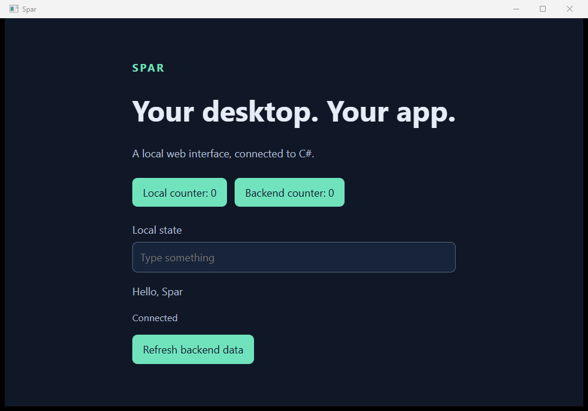

# Dependency compatibility acceptance

Executed on the PR #24 merge baseline `35915d5b73a5dd7d2fdd14c091c8ffc061e29c8c` plus the source changes hashed in `implementation.sha256`. The compatibility run completed at 2026-10-19 23:59 Europe/Rome. This is local integrated A15/A16 evidence; it does not establish external-package consumption or clean-machine qualification.

## Commands and observed outcomes

```powershell
dotnet build Spar.slnx --disable-build-servers
dotnet test --solution Spar.slnx --no-build
pwsh -NoProfile -File eng/Test-Compatibility.ps1 -EvidenceDirectory artifacts/compatibility/attempt-1 -VerifyRender
```

The solution build passed with zero warnings/errors. All 65 managed tests passed, none skipped (`build.log`, `tests.log`). `receipt.json` records all 13 command cases, expected outcomes, exact arguments, SDK 10.0.402, PowerShell 7.6.5, durations, and source identity. `fixture.sha256`, `fixture.csproj`, and `fixture-backend.cs` retain the isolated sample inputs. Logs and receipts retain the original artifact paths; their corresponding files are copied here by basename. Committed text logs have trailing whitespace/blank lines normalized; original logs remain under `artifacts/compatibility/`.

| Case | Actual result |
| --- | --- |
| Debug build | Succeeds with IL3050 at the call to `Spar.DynamicDependency.RuntimeGreeting.Create` |
| Strict AOT with incompatible dependency | Fails with error IL3050 naming the dependency API and DynamicMethod mechanism |
| Persisted CoreCLR choice | Publishes self-contained output with attributed schema-2 receipt |
| Syntax error under CoreCLR | Fails with C# compiler errors; no success receipt |
| Strict AOT plus conflicting PublishAot=false | Fails SPAR1004 |
| Missing compatibility reason | Fails SPAR1003 |
| Invalid Automatic mode | Fails SPAR1001 |
| Dependency/call/selection removed | Publishes and runs NativeAOT again without clearing an incompatibility cache |
| CoreCLR selection with strict override, compatible source | Publishes NativeAOT; receipt retains requested CoreCLR and strict=true |
| Framework DynamicMethod regression, CoreCLR selection | Framework source fails IL3050 |
| Same framework regression, strict AOT | Framework source fails IL3050 |
| Missing native compiler directory | Actual ilc invocation fails MSB3073, exit 3 |
| Unresolved native symbol | Actual native linker fails LNK2001/LNK1120 |

All nine expected failures returned nonzero and left no success receipt in their fresh output directories. The missing-compiler assertion was subsequently narrowed from a broad diagnostic match to `error MSB3073.*absent-native-compiler`; this exact assertion also passed against the retained raw log. No implementation changed after the run as a result of that assertion refinement.

## Actual copied applications

The test copied each non-symbol payload outside the checkout and executed the native app from that directory. The CoreCLR runtime configuration has no installed-framework dependency, and coreclr/hostfxr/hostpolicy DLLs are present. Payload hashes match the publication receipt; development/compiler assemblies are absent. `coreclr-boundary.log` also confirms Release inspection API/script exclusion and production entry-point/resource/frontend boundaries.

The CoreCLR greeting calls a separate dependency assembly that emits IL, creates a delegate, executes it and returns **Hello from generated code, Spar**. `coreclr-run/run-1.jsonl` records that actual return value before bridge completion and reports CoreCLR execution. The reviewed `coreclr.png` shows the same greeting and Connected status in the real WebView. After removing the dependency, the reviewed `aot.png` shows **Hello, Spar**, and its independent runtime events report NativeAOT. Rendering is supported by these captures and review, not just successful command exit.

Both copied-mode runs passed typed greeting, production-switch rejection, missing-WebView2 diagnostics, retained host/browser process exit, and profile lease release. Neither required forced cleanup. Each mode used one fresh profile; this is functional evidence, not a performance distribution. Publication receipts and run receipts retain payload sizes, source/tool versions, contracts, execution identities, and separately labeled host/browser memory observations.

After tightening the copied-payload check to compare the complete file inventory against the receipt and measure payload bytes before browser-profile creation, both published modes were rerun successfully (`coreclr-final-run/`, `aot-final-run/`). Those verification runs did not recapture unchanged pixels. The complete payloads, including receipts and excluding PDBs, were approximately 81.1 MB for CoreCLR and 4.1 MB for NativeAOT; these are single-fixture observations.

The real watcher regression also passed all three scenarios: patch/error/restart, startup/dependency build races, and explicit force during retirement (`backend-regression.json`). Its first two native captures were reviewed and retained. The runs accounted for 45, 87 and 18 retained process identities respectively, and the unrelated process survived each case. The regression finished after midnight, on 2026-10-20 Europe/Rome. This checks the new build import through actual copied-source development fixtures; it is not a new IDE debugger acceptance run. Actionlint 1.7.12 and `git diff --check` passed.




## First failure and limits

The first sandboxed solution-build attempt returned failure with no diagnostic count (`sandbox-first-build.log`). Re-running with access to the installed SDK/NuGet cache passed; this environment failure was retained and did not trigger a delivery-mode change. The compatibility acceptance itself passed on its first run. Expected negative cases above are successful rejection checks, not successful publications.

The frontend license-notice edits that predated this work were preserved in a named Git stash on `feat/10-production-assets`; they are not included in this compatibility slice or its payload claims. No clean machine without .NET was available. The fixture is an authored project dependency, not a claim about a third-party package. Dependency attribution remains an explicit developer decision; no automatic cause classifier, installer, external NuGet-consumer proof, or fresh IDE debugger acceptance is claimed.
