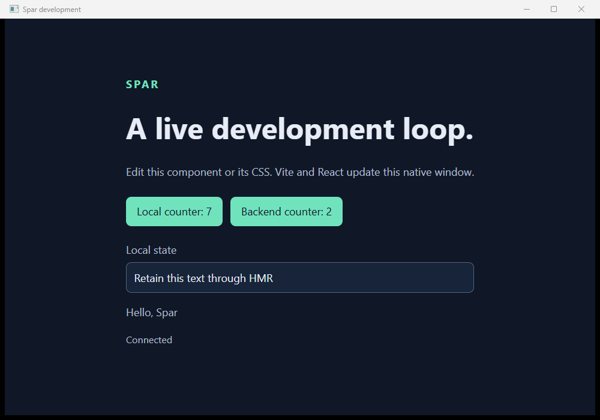
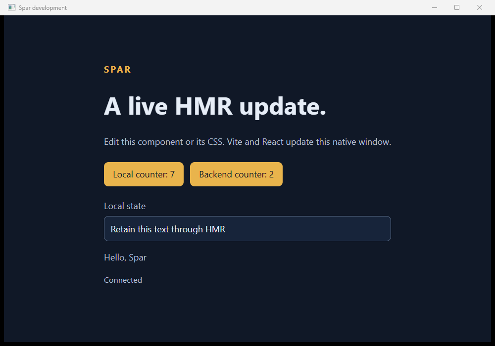

# M1.4 desktop and ownership evidence

Observed 2026-10-19, Windows/x64, SDK 10.0.402, Node 24.21.0, npm 11.19.0, VS Code 1.142.0. See [environment](environment.json) and [source snapshot](sources.sha256), hashed from staged Git bytes after line-ending normalization. Receipts record their actual executable hashes and process identities. Native/bridge regressions preceded the final development-only readiness/input refinements; the final session run also covers crash reporting. Editor ownership behavior was verified separately before that crash diagnostic was added. The snapshot includes authored implementation/test inputs, not generated output or installed dependencies.

Commands from the repository root:

```powershell
dotnet build Spar.slnx --disable-build-servers
dotnet test --solution Spar.slnx --no-build
pwsh -NoProfile -File eng/Test-DevelopmentSession.ps1 -EvidenceDirectory artifacts/development/desktop-verified -VerifyRender
pwsh -NoProfile -File eng/Test-VSCodeSession.ps1 -EvidenceDirectory artifacts/development/vscode-final
```

Also passed: `npm test` in `eng/bridge-client-tests`; `npm run check` and `npm run build` in the sample frontend; strict Release NativeAOT publication; existing native and bridge drivers against Debug CoreCLR and the copied AOT executable. [AOT copy](aot-copy.json) contains only `Spar.NativeSample.exe`, `WebView2Loader.dll`, and the two retained WebView2 license/notice files. No development assembly, compiler, Node process requirement, or managed runtime files enter that payload. Its UI is still the earlier local HTML bridge probe; production React asset packaging is not claimed.

## Session results

[Ten-session receipt](sessions.json): every scenario passed and the unrelated Node process survived. Process checks retain real handles and creation time before termination, then await actual exit. Short-lived processes can end before independent observation; these counts are observations, not a complete historical census.

| Scenario | Observed result |
| --- | --- |
| [Owned build, HMR, restart, native close](hmr-restart-close.jsonl) | One initial owned consumer build; matching typed readiness; CSS and React edits preserve mount, document, local counter 7, text, and backend counter 2. New app generation resets backend state while the original frontend process survives. Native close ends the session gracefully. 22 process identities independently retained. |
| [Owner stdin EOF](owner-pipe-eof.jsonl) | Explicit owner-disconnected forced policy, actual owned exit. |
| [Malformed owner UTF-8](malformed-owner-input.jsonl) | Explicit owner-input-failed forced policy, actual owned exit. |
| [Abrupt coordinator kill](abrupt-owner-kill.jsonl) | Only the coordinator was killed by the test. Job-handle closure ended the actual Vite/app/browser/helper/grandchild processes. No graceful completion event is invented after owner death. |
| [Frontend death](frontend-exit.jsonl) | Distinct frontend failure; application and remaining owned work end. |
| [Application crash](application-exit.jsonl) | Distinct application failure with nonzero session exit; owned frontend/helpers end. Ordinary native close remains successful. |
| [Occupied port](port-conflict.jsonl) | Distinct port-conflict failure before frontend/application launch. |
| [Startup timeout](startup-timeout.jsonl) | Non-advertising frontend fails readiness; remaining owned helper is explicitly terminated. |
| [Missing application](application-start-failure.jsonl) | Distinct application-launch failure; frontend cleaned up. |
| [Wrong renderer capability](client-credential-denied.jsonl) | `client_unauthorized`; no successful bridge connection. Managed bridge test separately verifies no handler entry before credential proof. |

The first scenario's actual `PrintWindow` captures passed the accent-color pixel check and were visually reviewed. PNGs below are lossless format conversions of the original BMPs, with no content edits. Both show retained local counter, backend counter, and text; after HMR, the heading changes and the accent turns from teal to yellow. Combined with native/document/process receipts, this establishes **A02** for this consumer.





## Editor and runtime regressions

[VS Code results](vscode.json): actual `TaskExecution.terminate()` and `workbench.action.closeWindow` each ended the isolated editor owner and all 14 independently retained coordinator/child identities. [Task actions](vscode-task-stop-editor.jsonl), [task process events](vscode-task-stop-coordinator.jsonl), [window actions](vscode-window-close-editor.jsonl), and [window process events](vscode-window-close-coordinator.jsonl) preserve the evidence. These are real task/window tests, **not integrated C# debugger Hot Reload evidence**. Full editor stdout/stderr stays under the ignored original run directory.

Native lifecycle and bridge receipts: [CoreCLR host](coreclr-native.json), [CoreCLR bridge](coreclr-bridge.json), [copied AOT host](aot-native.json), [copied AOT bridge](aot-bridge.json). These regression runs did not request interactive pixel verification; previous M1.2/M1.3 rendering evidence remains separate. Forty managed tests passed with none skipped. The frontend TypeScript/build and generated-client TypeScript checks passed.

Earlier failed configuration/npm/harness attempts remain under `artifacts/development` and are described in the [guide](../../11-development-session.md#verification-and-evidence). No failed or skipped run is counted here. Startup/restart timestamps are available in events, but repeated controlled performance measurements and save-to-update timing have not been established.

Backend update integration, contract-edit restart, full debugger lanes, generic AI UI actions, explicit external frontend mode, production SPA packaging, clean-machine qualification, and external packages remain open. This evidence does not complete A01 or A03–A18 or the milestone.
