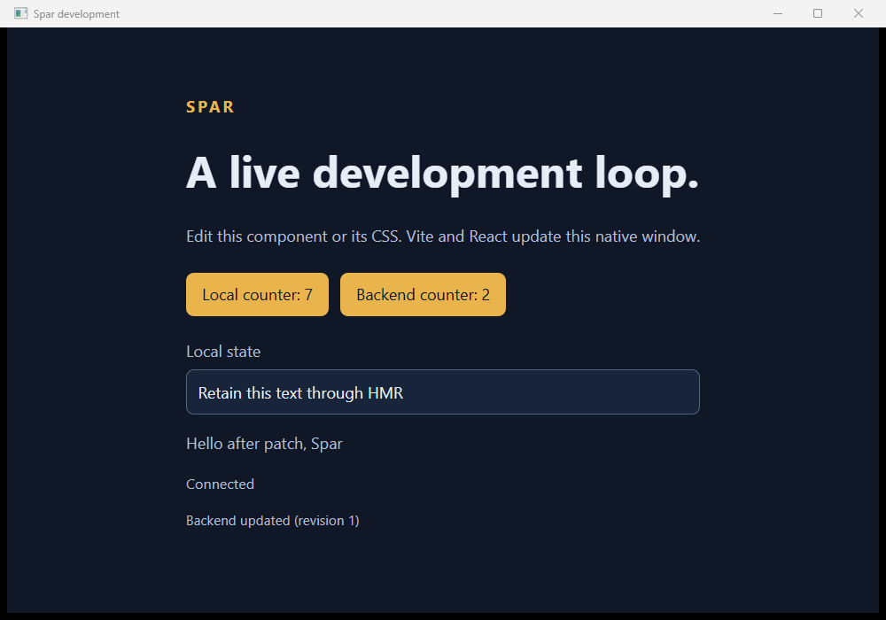
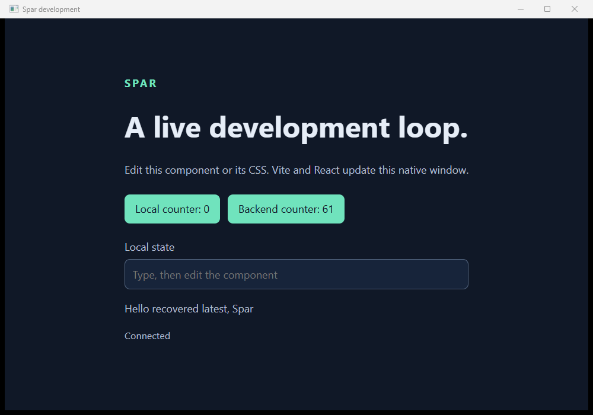

# Restart policy and selected build evidence

Observed 2026-10-19 on Windows/x64. This extends the [first native backend update proof](../backend-updates-2026-10-19/README.md), using the same SDK-owned patch engine and actual Win32/WebView2 consumer. See [tool versions](environment.json), [implementation and driver hashes](sources.sha256), and the [supported input policy](../../12-backend-updates.md#restart-inputs-and-full-build-selection).

## Commands and results

```powershell
dotnet build Spar.slnx --disable-build-servers
dotnet test --solution Spar.slnx --no-build
pwsh -NoProfile -File eng/Test-BackendUpdates.ps1 -EvidenceDirectory artifacts/backend-loop/restart-races-final -VerifyRender
pwsh -NoProfile -File eng/Test-DevelopmentSession.ps1 -EvidenceDirectory artifacts/backend-loop/restart-races-spa
pwsh -NoProfile -File eng/Test-VSCodeSession.ps1 -WatchBackend -EvidenceDirectory artifacts/backend-loop/restart-races-vscode
```

Build: zero warnings/errors. Managed tests: **48 passed, zero failed/skipped**, including six source-manifest tests and the real console watcher scenarios. [Ten SPA lifecycle regressions](spa-regressions.json) passed. [Both installed VS Code task/window ownership checks](vscode-watch.json) passed and each independently retained 19 coordinator/child process identities through actual exit. They do not attach the C# debugger.

The [three native backend flows](backend-sessions.json) passed. The complete generation events are retained: [patch/error/contract recovery](patch-error-restart.jsonl), [startup/dependency/build races](startup-dependency-build-races.jsonl), and [explicit force during retirement](explicit-force-during-retirement.jsonl). Initial isolated input hashes are retained alongside each event file. Full failed-build output remains under the ignored artifact directory named above; selected compiler diagnostics also appear in the event stream.

## Deterministic full-build races

The driver adds an ordinary MSBuild `AfterTargets="Build"` target to the isolated consumer. It pauses completion after actual compilation using files outside the monitored source roots. No production test hook, fake compiler, SDK private API, or second patch engine is involved. Source edits and the failure injection are in the committed driver.

| Generation | Observed outcome |
| --- | --- |
| 1 | Original consumer becomes ready. |
| 2 | Configured startup source changes; a replacement reruns initialization and exposes counter 11. |
| 3 | A referenced dependency project's compilation symbol changes; the rebuilt dependency changes initialization to counter 12. |
| 4 | Build compiles counter 21, then newer startup/method source arrives while completion is gated. Successful build is superseded and no application process starts. |
| 5 | Newest valid source becomes ready: counter 31 and `Hello selected latest, Spar`. |
| 6 | Another successful compilation is superseded by a newer invalid method edit before completion. No application starts. |
| 7 | Selected newest build fails with file/line CS0103. Backend remains stopped; no earlier successful output is activated. |
| 8 | Source correction alone recovers to counter 41 and `Hello recovered latest, Spar`; no restart command is sent. |
| 9 | After compilation, newer startup source arrives and the gated target deliberately fails. `build-superseded/build_failed` discards that obsolete failure; no current failed-update diagnostic is published. |
| 10 | Newest valid build becomes ready with counter 61. |

One frontend process survives all attempts. Each admitted application retires and actually exits before its replacement starts. The existing 12-second cancellation-ignoring operation still finishes before graceful replacement; explicit force remains a separate terminal outcome and starts no replacement. An unrelated Node process survives all three flows. Retained process identities are observations, not a census of every short-lived helper.

`buildSourceHash` and `sourceRevision` correlate each selected full build and its resulting process. The revision also catches observed edit/revert activity even when final bytes match. Unit checks cover atomic replacement/deletion, output/frontend exclusions, configured startup and project edits, nested contract inputs, and size limits. These receipts describe the declared input boundary; they do not promise atomic snapshots of arbitrary MSBuild inputs or transactional SDK patches.

## Desktop and editor evidence

Both native captures passed their accent-pixel check and were visually reviewed. The PNG files are lossless format conversions of the captured BMPs, with no content edits. The patched UI retains local counter 7, text, backend counter 2, and the updated greeting. The recovered UI shows counter 61 and the newest greeting after the full-build races.





The editor receipts retain [task Stop actions](vscode-task-stop-editor.jsonl), [task coordinator events](vscode-task-stop-coordinator.jsonl), [window-close actions](vscode-window-close-editor.jsonl), and [window coordinator events](vscode-window-close-coordinator.jsonl). The probe now builds initially in watch mode instead of passing `--no-build`. Editor checks ran before the final nested-contract classification fix and added superseded-build outcome label; the final managed/native rerun covers those changes. Neither changes editor ownership behavior.

## Scope and first failures

This delivery supplies the remaining issue #6 restart-policy and selected full-build recovery scenarios for the documented watcher input boundary. It does not complete debugger lanes (#8/#9), production SPA asset packaging, compatibility publication, generic AI inspection, or external-package consumption. NativeAOT publication was not rerun locally for this development-only change; the required upstream CI job retains its strict publication and copied-payload gates. Earlier AOT results remain historical evidence, not a new execution claim.

Initial failed attempts remain under `artifacts/backend-loop/restart-races-first` and `restart-races-second`: output-directory creation initially advanced the source revision without changing bytes; the dependency fixture initially lacked a namespace and failed CA1050. Directory-event filtering and the fixture were corrected. `restart-races-third` passed all three native flows; the final rerun adds the nested-contract fix, explicit superseded-build outcomes, and the expanded fixture source manifest. Failed or superseded attempts are never counted as accepted generations.
