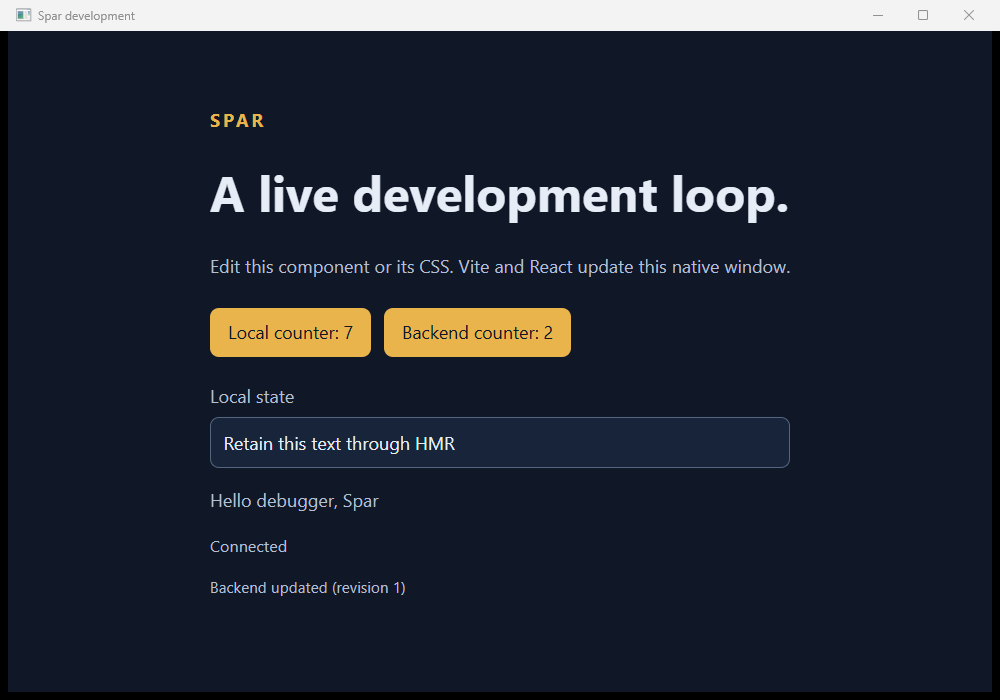
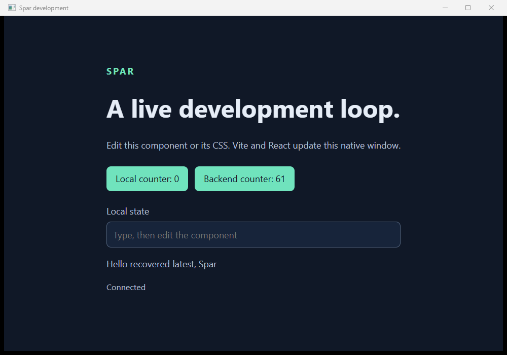

# Native VS Code debugger evidence

Observed on Windows/x64 on 2026-10-19: VS Code 1.142.0, C# 2.160.4, C# Dev Kit 3.40.210, SDK 10.0.402, Node 24.21.0/npm 11.19.0, PowerShell 7.6.5. The [guide](../../13-vscode-development.md) describes the supported launch/restart flow and limitations. [Source hashes](sources.sha256) identify changed implementation/test inputs plus baseline tool configuration; fixture hashes identify the copied initial consumer sources. Baseline upstream commit: `994d91a1d84dc779e74c9448c4677f0a1ec80cb0`.

## Integrated debugger result

Command: `pwsh -NoProfile -File eng/Test-VSCodeDevelopment.ps1 -VerifyRender` after a successful solution build. [Receipt](debugger.json), [coordinator events](coordinator.jsonl), [selected debugger events](debugger-events.jsonl), and [initial fixture sources](fixture-sources.sha256) come from `artifacts/vscode-development/debugger-64e4ca4fd81649538603d86115314495`.

The real Extension Development Host drove the public `spar` F5 launcher, which delegated to ordinary C# Dev Kit debugging. It exercised:

- Native backend breakpoint/continue, authenticated job admission, matching typed readiness, and actual frontend CSS HMR.
- A real C# method patch and metadata callback in the same process/document. Local counter **7**, backend counter **2**, text, and mount remained intact; greeting became **Hello debugger, Spar**.
- CS0103 rejection without activating the failed edit, followed by correction and an in-process update.
- Dev Kit's actual ENC0014 base-class diagnostic. Spar's restart command began while a cancellation-ignoring 12-second operation was still running, then waited for its completion and old process exit before launching generation 2. A breakpoint hit again in the relaunched debugger.
- Contract source change caused retirement and a failed full build. The contract did not enter delta application. The adapter exposed CS7036 at `SampleBackend.cs:20` through a source-located diagnostic; correcting the call rebuilt and admitted generation 4 with a different matching fingerprint.
- Debugger Stop ended the first session with **forced_cleanup**. A fresh second session ended through native WM_CLOSE with **graceful / application_closed**. Both coordinators returned zero. The independent supervisor retained and confirmed exit of **45** process creation identities across the sessions.

No `dotnet watch` process was started in this lane. Positive patch evidence is the application callback and changed typed result, not an editor command returning success. The unsupported-edit log line is retained only as test evidence; product control does not parse private Dev Kit logs.

The supervising PowerShell process captured the actual native window and counted **15,616** yellow accent pixels. The lossless PNG conversion below was visually reviewed: retained counters/text, changed greeting, connected status, and update revision are visible. This establishes rendering for the recorded debugger session.

## Regressions

`dotnet build Spar.slnx --disable-build-servers` succeeded without warnings; `dotnet test --solution Spar.slnx --no-build` passed **51** tests, none skipped. `npm run check` and `npm run build` in the sample frontend succeeded; Node syntax checks passed for the adapter and editor harness.

[Ten SPA scenarios](spa-regression.json), run with `eng/Test-DevelopmentSession.ps1 -EvidenceDirectory artifacts/development/debugger-regression`, all passed after fixing stale React-effect readiness reports. Intentional startup/crash scenarios retain their expected nonzero exits. This regression did not request desktop pixels.

[Three terminal watcher scenarios](watcher-regression.json), run with `eng/Test-BackendUpdates.ps1 -EvidenceDirectory artifacts/backend-loop/debugger-regression -VerifyRender`, all passed. Independently retained identities: **45**, **87**, and **18**; the unrelated Node process survived. The patch and recovered-race native captures were also visually reviewed. This watcher run preceded the later frontend report-order fix; the ten-session regression and final debugger run include that fix.

The last editor run preceded only the adapter's 2,048-character outgoing diagnostic cap; ordinary diagnostics in this run were below that bound. The cap received a syntax check. NativeAOT behavior is unchanged by these development-only settings and remains covered by the required CI lane; this local debugger receipt is not an AOT or Visual Studio acceptance claim.

## Retained failures and limits

Failed attempts were kept and were not counted as acceptance:

- [Initial handoff failure](first-launch-failure.json): Dev Kit replaced launch arguments. The final `coreclr` configuration hook now supplies the private arguments/environment.
- [Provider-order failure](provider-order-failure.json): competing `dotnet` resolvers could leave an unresolved debugger type. The final adapter owns a separate `spar` launcher and delegates with `startDebugging`.
- [Early-save failure](early-save-failure.json): Dev Kit reported ENC1008 while its baseline was settling. The harness records a two-second interval after initial readiness and CSS HMR. No public Hot Reload-ready signal or immediate-save guarantee is invented.
- [Child capture failure](child-capture-failure.json): capture from a process spawned inside the editor returned black pixels. The passing capture comes from the independent supervisor. Making the editor child asynchronous alone did not fix it.
- [Stale snapshot failure](stale-snapshot-failure.json): an older report from a retired React effect arrived after the updated counter report. The sample now discards these reports after asynchronous waits.

A fixture helper initially inherited `LibraryOnly` from a dot-sourced script and returned without executing scenarios. That invocation supplied no acceptance; the flag is now preserved before sourcing and the three-scenario regression above actually ran. A render flag was also lost through sourcing in an intermediate run; its receipt correctly said `not-exercised`. JavaScript `window.close()` did not request the host close path; the final native-close test uses the established Win32 test helper.

Interactive rude-edit modal choices, the generic debugger toolbar's Restart, broad project-layout compatibility, VS Code window-close with this debugger adapter, and integrated Visual Studio remain unverified here. The documented Spar restart command is the verified flow. Existing task-window-close evidence is separate. Short-lived processes may end before independent observation; retained-handle counts are not a complete historical process census. Full raw logs and failed fixture directories remain under ignored `artifacts/`; they contain junctions and must not be recursively deleted as routine cleanup.
